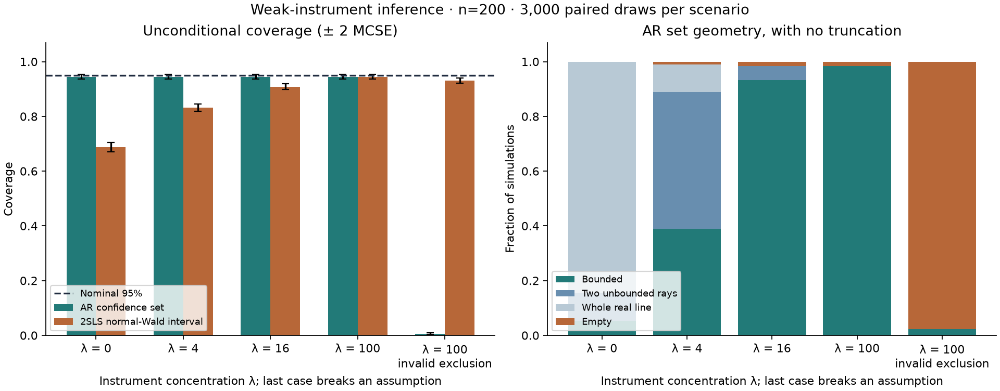
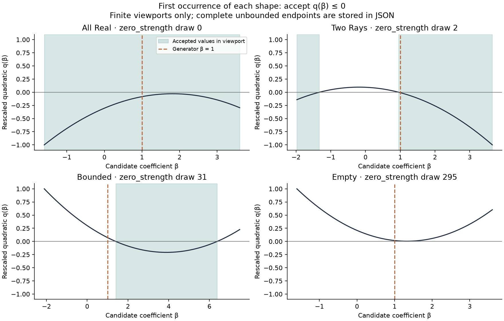

# Weak-instrument confidence sets

[](https://github.com/lcx0731/weak-instrument-confidence-sets/actions/workflows/tests.yml)

An original educational implementation of classical Anderson–Rubin (AR) test
inversion for one endogenous regressor, compared with conventional two-stage
least squares (2SLS) normal-Wald intervals. It retains bounded intervals, two
unbounded rays, the whole real line, and empty sets instead of silently clipping
them to a plotting grid. These are standard statistical methods, not a new
causal estimator. All observations are explicitly synthetic.

**A valid confidence procedure need not give a useful finite interval.** In the
checked-in zero-relevance experiment, nominal 95% Wald intervals cover the
generator's coefficient only 68.70% of the time. AR sets cover it 94.43% of the
time, but 94.70% of those sets are unbounded. An invalid-instrument stress case
shows why weak-instrument robustness is not a substitute for valid identification.



## Reproduce

Requires Python 3.11 or newer:

```bash
git clone https://github.com/lcx0731/weak-instrument-confidence-sets.git
cd weak-instrument-confidence-sets
python3 -m venv .venv
source .venv/bin/activate
python -m pip install '.[test]'
python -W error -m pytest -q
python -W error -m weak_iv.experiment --output results
```

The default experiment uses 3,000 draws per scenario, 200 observations, two
excluded instruments, and seed `20261011`. It produces a JSON summary and two
figures. No external dataset or credentials are needed.

The installed CLI `weak-iv-audit --output results` is equivalent. Optional flags
are `--replicates`, `--n`, and `--seed`. For the recorded Python 3.13 environment:

```bash
python -m pip install -r requirements-repro.txt
python -m pip install --no-deps .
```

Use a regular wheel install as above; reinstall after editing source. Fixed seeds
make the JSON reproducible in the same environment. Numerical last bits and PNG
rendering can vary across platforms or dependency versions. CI independently
tests the supported dependency ranges on Python 3.11 and 3.13.

## Model and implementation

The API has one endogenous regressor `x`, excluded instruments `Z`, and included
exogenous controls `W`. An intercept is always added to `W`; do not supply it
again. A valid structural model is

```text
y = beta*x + W*gamma + u,    u | (W,Z) ~ N(0, sigma^2 I).
```

`x` may depend on `u`; `W` and `Z` may not. QR decompositions residualize `y`,
`x`, and `Z` against the included controls. Write the residualized vectors as
`yr`, `xr`, the projection onto the residualized instruments as `P`, and the
residual projection after both controls and instruments as `M`. With `k`
excluded instruments, `p` included columns counting the intercept, and
`d = n-p-k`, the AR statistic at candidate `b` is

```text
r(b) = yr - b*xr
F_AR(b) = [r(b)' P r(b) / k] / [r(b)' M r(b) / d].
```

Under the null `b = beta` and the stated assumptions, numerator and denominator
are independent scaled chi-squares, giving the `F(k,d)` reference. No first-stage
estimate divides the structural residual. The confidence set contains **every**
real `b` for which `F_AR(b) <= F_critical`.

### Inversion without a finite search grid

Let `tau = k*F_critical/d`. Expand the acceptance inequality:

```text
q(b) = a*b^2 + h*b + c <= 0
a = xr' P xr - tau * xr' M xr
h = -2 * (xr' P yr - tau * xr' M yr)
c = yr' P yr - tau * yr' M yr.
```

The solver handles quadratic, linear, constant, and repeated-root cases. It
preserves small **nonzero** leading coefficients, since replacing one with zero
can change a bounded set into a half-line. Discriminants and cancellation-safe
roots use Python's standard-library `decimal` at 80-digit precision, starting
from the supplied floating-point coefficients. This does not recover precision
lost while forming the cross-products. A finite root that cannot be represented
as a floating-point endpoint raises an explicit error rather than being silently
replaced with infinity.

All matrix projections use thin QR coordinates and residual vectors; no dense
`n` by `n` projection matrix or explicit matrix inverse is constructed.
Rank-deficient instruments, instruments in the control span, invalid dimensions,
nonfinite data, and nonpositive residual degrees of freedom are rejected.

In JSON, `null` as a **lower** endpoint means negative infinity and `null` as an
**upper** endpoint means positive infinity. For example, `[[null,-1],[2,null]]`
means `(-infinity,-1] union [2,infinity)`. `[]` means empty; `[[null,null]]` means
all real numbers. JSON never contains nonstandard `Infinity` or `NaN` tokens.

### The conventional comparison

The baseline uses

```text
beta_2SLS = (xr' P yr) / (xr' P xr)
s^2 = ||yr - beta_2SLS*xr||^2 / (n-p-1)
se = sqrt(s^2 / (xr' P xr))
interval = beta_2SLS +/- normal_quantile(1-alpha/2)*se.
```

These are homoskedastic, normal-Wald limits, not an exact finite-sample t interval
and not heteroskedasticity-robust inference. Zero fitted endogenous variation
makes 2SLS undefined and raises an error. The first-stage excluded-instrument F
statistic is reported as a diagnostic, not used to screen the coverage sample.

## Fully specified experiment

There are `n=200` observations and two fixed instruments. A seeded Gaussian
matrix is centered and orthogonalized to obtain `Z'Z = n I` and zero column
means. Independently for each Monte Carlo draw, generate iid standard-normal
vectors `v` and `e` and set

```text
u = 0.8*v + 0.6*e
x = sqrt(lambda/n)*Z[:,0] + v
y = 1.0*x + delta*Z[:,1] + u.
```

The first-stage concentration parameter is `lambda` because `Var(v)=1` and
the first instrument has squared norm `n`. The four valid scenarios use
`lambda in {0,4,16,100}` and `delta=0`. The stress scenario uses `lambda=100`
and `delta=0.35`, explicitly violating exclusion. At `lambda=0`, the generator's
structural coefficient is known for validation but is not identified by the
excluded instruments.

All scenarios reuse the **same innovations** as well as the same fixed `Z`.
Each scenario has 3,000 independent draws; scenarios are paired, not independent.
At the true coefficient, the AR residual is the same `u` in every valid scenario,
so their identical simulated AR coverage is intentional. The JSON reports paired
AR-minus-Wald coverage differences with MCSE computed from per-draw differences.

Coverage MCSE is the sample standard deviation of the draw-level indicator divided
by `sqrt(3000)`. Figure error bars show approximately two MCSEs. Conditional
coverage is reported separately with its own denominator, never substituted for
the all-draw headline rate. Length summaries for bounded AR sets are explicitly
conditional on that shape; an unconditional finite mean length is not reported.

### Recorded results

All percentages below use **all 3,000 draws** per scenario. Parentheses contain
one MCSE in percentage points for coverage.

| Scenario | Median first-stage F | AR coverage | Wald coverage | Unbounded AR | Empty AR |
|---|---:|---:|---:|---:|---:|
| Zero relevance, lambda=0 | 0.69 | 94.43% (0.42) | 68.70% (0.85) | 94.70% | 0.07% |
| Weak, lambda=4 | 2.52 | 94.43% (0.42) | 83.17% (0.68) | 60.03% | 1.10% |
| Intermediate, lambda=16 | 8.54 | 94.43% (0.42) | 90.87% (0.53) | 5.13% | 1.53% |
| Strong, lambda=100 | 50.68 | 94.43% (0.42) | 94.43% (0.42) | 0.00% | 1.63% |
| Invalid exclusion, lambda=100 | 50.68 | 0.60% (0.14) | 93.13% (0.46) | 0.00% | 97.80% |

Two cautions matter:

1. At zero relevance, AR coverage **conditional on the 157 bounded sets** is only
   53.50% (MCSE 3.99 percentage points). The 2,531 whole-real-line sets necessarily
   cover every finite coefficient. Near-nominal overall coverage does not turn a
   particular bounded set into a well-identified estimate.
2. The invalid-exclusion stress is designed to violate the second instrument's
   restriction in a direction orthogonal to the first-stage signal. Its fairly
   high Wald coverage is specific to this geometry, not evidence that invalid
   instruments are harmless. AR rejects all coefficients in most of these draws.
   Empty sets can also occur under the **valid** model, so emptiness alone is not
   proof of an exclusion violation.

### Analytic checks against the generator

The valid-case AR coverage target is exactly `1-alpha = 0.95` conditional on the
fixed design, averaging over repeated error draws. Under the specified invalid
case, the statistic at the generator's coefficient has a noncentral F law with
noncentrality `n*delta^2 = 24.5`, giving analytic coverage about **0.456%**. The
observed 0.60% is a Monte Carlo estimate, not a new theoretical claim.

Except for zero-probability boundary cases, the AR set is unbounded exactly when
its leading quadratic coefficient is negative, equivalently when the first-stage
F statistic is below the **same AR critical value**. Thus its probability under
this generator is the noncentral-F CDF at that value with noncentrality `lambda`.
The JSON records both analytic benchmarks. These are oracle checks using known
simulation parameters, not diagnostics available without assumptions in real data.



The geometry figure uses the **first observed occurrence** of each shape in
scenario/draw order. These selected illustrations are not a second coverage
sample. Each panel has a finite display viewport, while the JSON retains the
entire set, including both tails. All four illustrated shapes already occurred
in the valid zero-relevance scenario.

## Using the core API

```python
from weak_iv import IVDesign

# z: (n,k) excluded instruments; y and x: (n,) vectors.
# Optional controls omit the intercept; it is added automatically.
fit = IVDesign(z, controls=controls).fit(y, x)
confidence = fit.ar_confidence_set(alpha=0.05)
print(confidence.kind, confidence.to_dict())
print(confidence.contains(1.0), fit.first_stage_f(), fit.wald())
```

`controls` is optional. The API example assumes caller-supplied arrays; the CLI
provides the complete runnable synthetic generator.

## Tests and structure

The 49 test cases cover all quadratic geometries (including half-lines and
singletons), nearly repeated roots, large coefficient ranges, nonzero small
leading coefficients, safe JSON endpoints, AR statistics against independently
fitted nested regressions, 2SLS against a two-stage matrix calculation, analytic
inversion versus pointwise tests, nuisance and instrument-basis invariance,
first-stage/geometry equivalence, invalid inputs, central and noncentral-F
Monte Carlo checks, pairing, and the end-to-end CLI.

```text
src/weak_iv/core.py        QR-based statistics, confidence sets, quadratic solver
src/weak_iv/experiment.py  Generator, paired simulation, summary and plots
tests/                    Mathematical, reference and integration tests
results/                  Actual generated JSON and two figures
```

This project demonstrates statistical identification, careful numerical
implementation, repeated-sampling validation, and explicit assumption checks.

## Scope

The AR F reference requires a correctly specified linear model with iid
homoskedastic Gaussian structural errors independent of the fixed instruments
and included controls. It is robust to weak first-stage relevance, not to invalid
instruments, heteroskedasticity, clustering, or an incorrect outcome equation.
The example includes an explicitly invalid-exclusion stress case. It does not
constitute empirical causal evidence, financial advice, or a production inference
service.

Additional limits: only one endogenous regressor is supported; there is no
heteroskedasticity/cluster correction, CLR procedure, multiple-endogenous-variable
projection, or real-data identification argument. Numerical extreme-conditioning
guarantees are not claimed. A perfect zero AR residual has a documented closure
convention (`F=0`, accepted, flagged as degenerate); it has probability zero under
the assumed nondegenerate model. An empty set is not an estimate of zero.
The simulation uses one fixed instrument design and one seed, not a broad
empirical benchmark. No personal records, private research, or external dataset
is used.

## Sources

- Davidson and MacKinnon, [Confidence Sets Based on Inverting Anderson–Rubin Tests](https://academic.oup.com/ectj/article/17/2/S39/5056440),
  *The Econometrics Journal* (2014): test inversion, set geometry, and limitations
  of unconditional coverage. The source is background, not copied code or data.
- [SciPy F distribution documentation](https://docs.scipy.org/doc/scipy/reference/generated/scipy.stats.f.html):
  finite-sample reference quantiles and survival probabilities.
- [SciPy noncentral F distribution documentation](https://docs.scipy.org/doc/scipy/reference/generated/scipy.stats.ncf.html):
  generator-specific analytic benchmarks.

Code is licensed under [MIT](LICENSE).
